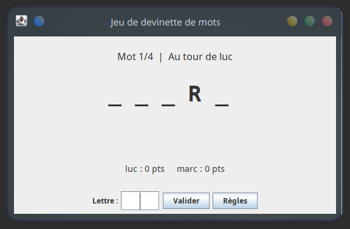

<div align="center">

# Jeu de devinette de mots

**Un duel de lettres en Java, en console ou en fenêtre**




</div>

---

## À propos

Projet réalisé dans le cadre d'un TP de programmation orientée objet, en L2 cybersécurité. Deux joueurs s'affrontent pour découvrir quatre mots tirés au sort, lettre par lettre.

## Règles du jeu

| | |
|---|---|
| **Joueurs** | 2, chacun son tour |
| **Mots** | 4, tirés au sort, une lettre révélée au départ |
| **Bonne lettre** | elle apparaît dans le mot, et le joueur rejoue |
| **Mauvaise lettre** | la main passe à l'adversaire |
| **Mot complété** | les points vont à celui qui place la dernière lettre |
| **Fin** | le meilleur score gagne, égalité = match nul |

### Barème

| Longueur du mot | Points |
|:---:|:---:|
| 3 lettres | 15 |
| 4 lettres | 20 |
| 5 lettres | 30 |
| 6 lettres et plus | 50 |

> **Indice** : pour un mot de plus de 6 lettres, les joueurs peuvent révéler sa catégorie. Les deux doivent être d'accord, et le mot ne vaut plus que 25 points.

## Lancer le jeu

```bash
git clone https://github.com/Vyx/jeu_devinette.git
cd jeu-devinette
javac *.java
```

| Version | Commande |
|---|---|
| Console | `java Main` |
| Fenêtre | `java FenetreJeu` |

## Architecture

```
jeu-devinette/
├── Joueur.java        nom et score d'un joueur
├── Mot.java           mot masqué, vérification des lettres, points
├── Dictionnaire.java  chargement de mots.txt et tirage au sort
├── Partie.java        déroulement d'une partie en console
├── Main.java          menu console
├── FenetreJeu.java    interface graphique
└── mots.txt           dictionnaire au format mot;categorie
```

Les classes `Joueur`, `Mot` et `Dictionnaire` sont partagées par les deux versions : seule la façon de faire jouer change.

<details>
<summary><b>Notions de POO mises en œuvre</b></summary>

- **Encapsulation** : attributs privés, scores modifiables uniquement par ajout
- **Collections** : `List` pour les mots, `Set` pour les lettres trouvées
- **Fichiers** : lecture du dictionnaire avec `BufferedReader`
- **Exceptions** : saisies invalides et fichier introuvable gérés sans plantage
- **Héritage** : `FenetreJeu` hérite de `JFrame`
- **Programmation événementielle** : l'interface réagit aux clics

</details>

## Ajouter des mots

Ouvre `mots.txt` et ajoute une ligne par mot, sans accents :

```
ordinateur;informatique
```

---

<div align="center">

Réalisé par **Vyx** · [Mes notes Java et POO](https://github.com/Vyx-22/java_poo)

</div>